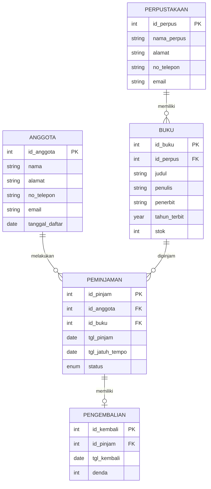

<div align="center">

# 📚 Sistem Informasi Perpustakaan

### Aplikasi Web Perpustakaan Berbasis PHP Native & MySQL

[](https://php.net)
[](https://mysql.com)
[](LICENSE)
[]()

**Aplikasi siap pakai untuk tugas kuliah, portofolio, atau pembelajaran PHP Native.**

[Fitur](#-fitur) • [Instalasi](#-instalasi) • [Screenshot](#-screenshot) • [Teknologi](#-teknologi)

</div>

---

## ✨ Fitur

- 🔐 **CRUD Buku** —
  Tambah, lihat, hapus data buku dengan mudah
- 📋 **Manajemen Peminjaman** —
  Riwayat lengkap transaksi peminjaman
- 🔄 **Sistem Pengembalian** —
  Pencatatan tanggal kembali & denda otomatis
- 🎨 **UI Modern** —
  Desain responsif dengan gradient & hover effect
- 📊 **Multi-Tabel JOIN** —
  Relasi 5 tabel database yang rapi
- 📱 **Mobile Friendly** —
  Tampil cantik di HP maupun desktop
- 📦 **Database Lengkap** —
  File `.sql` siap import + data dummy

---

## 🚀 Instalasi

### Persyaratan
- PHP 7.4 atau lebih baru
- MySQL / MariaDB
- Web server (Apache/Nginx) — atau **Ksweb** untuk di Android

### Langkah Cepat

**1. Clone / Download Repository**
```bash
git clone https://github.com/[risnandi-commits]/[Sistem-Perpustakaan-php].git
cd [Sistem-Perpustakaan-php]
```

**2. Import Database**

· Buka phpMyAdmin → Buat database baru bernama db_perpus
· Klik tab Import → pilih file database/database_perpus.sql → Go

**3. Sesuaikan Koneksi Database**

Buka file index.php, cari baris:

```php
$koneksi = mysqli_connect("localhost", "root", "", "db_perpus");
```

Sesuaikan user dan password dengan server kamu.

**4. Jalankan Aplikasi**

Akses lewat browser:

```
http://localhost/perpus/index.php
```

✅ Selesai! Aplikasi siap digunakan.

---

### 🗄️ Struktur Database

Aplikasi ini menggunakan 5 tabel dengan relasi yang saling terhubung:



---

## 🛠️ Teknologi

**Teknologi Deskripsi**
https://img.shields.io/badge/-PHP-777BB4?style=flat&logo=php&logoColor=white Backend logic & routing
https://img.shields.io/badge/-MySQL-4479A1?style=flat&logo=mysql&logoColor=white Database penyimpanan data
https://img.shields.io/badge/-HTML5-E34F26?style=flat&logo=html5&logoColor=white Struktur halaman
https://img.shields.io/badge/-CSS3-1572B6?style=flat&logo=css3&logoColor=white Styling modern responsif

---

## 📂 Struktur Folder

```
perpus/
├── assets/
│   └── css/
│       └── style.css
├── database/
│   └── database_perpus.sql
├── screenshots/
│   ├── 1_Book_List.png
│   ├── 2_Loan_List_Book.png
│   └── 3_Add_a_New_Book.png
├── index.php
├── README.md
├── LICENSE
└── file.gitignore
```

---

## 💡 Kustomisasi

Ingin menyesuaikan aplikasi? Beberapa tips:

- Ganti nama perpustakaan: Edit langsung di bagian .header pada index.php
- Ubah warna tema: Buka assets/css/style.css, ganti kode warna #4e54c8# sesuai selera
- Tambah kolom database: Jangan lupa update query INSERT dan tampilan tabel

---

## 🤝 Kontribusi

Pull request sangat diterima! Untuk perubahan besar, silakan buka issue terlebih dahulu.

1. Fork repository ini
2. Buat branch fitur (git checkout -b fitur/FiturBaru)
3. Commit perubahan (git commit -m 'Menambah fitur baru')
4. Push ke branch (git push origin fitur/FiturBaru)
5. Buka Pull Request

---

## 📄 Lisensi

Proyek ini dilisensikan di bawah MIT License — bebas digunakan untuk keperluan pribadi maupun komersial.

---

## 👨‍💻 Author

Risnandi Jaya S

- GitHub: @risnandi-commits
- Email: risnandjayas@gmail.com

---

<div align="center">

⭐ Kalau proyek ini bermanfaat, jangan lupa kasih bintang ya! ⭐

Dibuat dengan ❤️ dari [Bandung]

</div>
```

---
